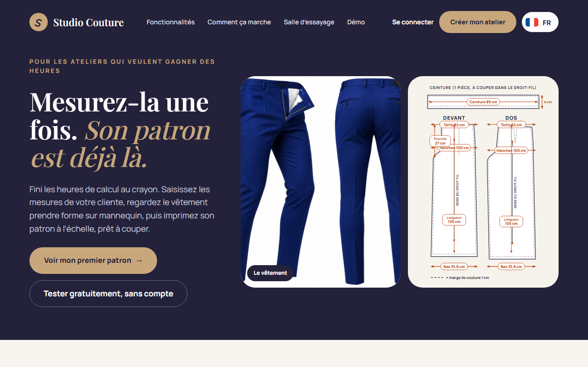
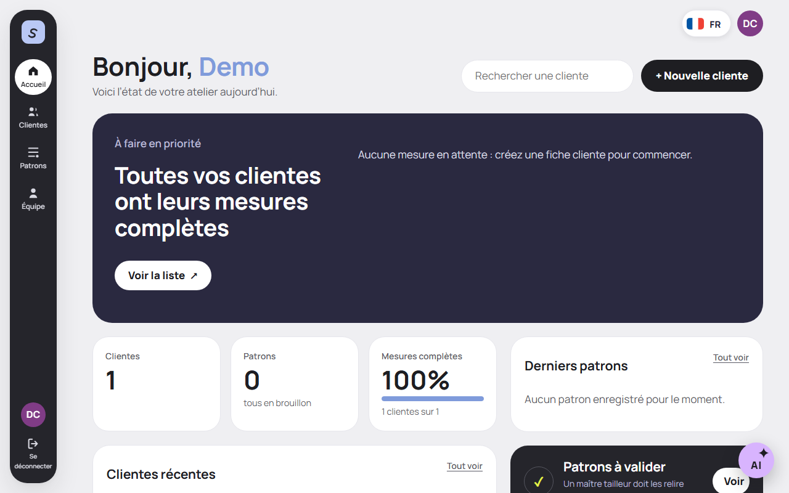
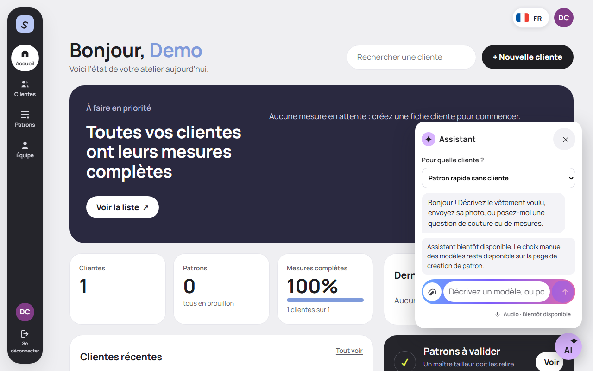
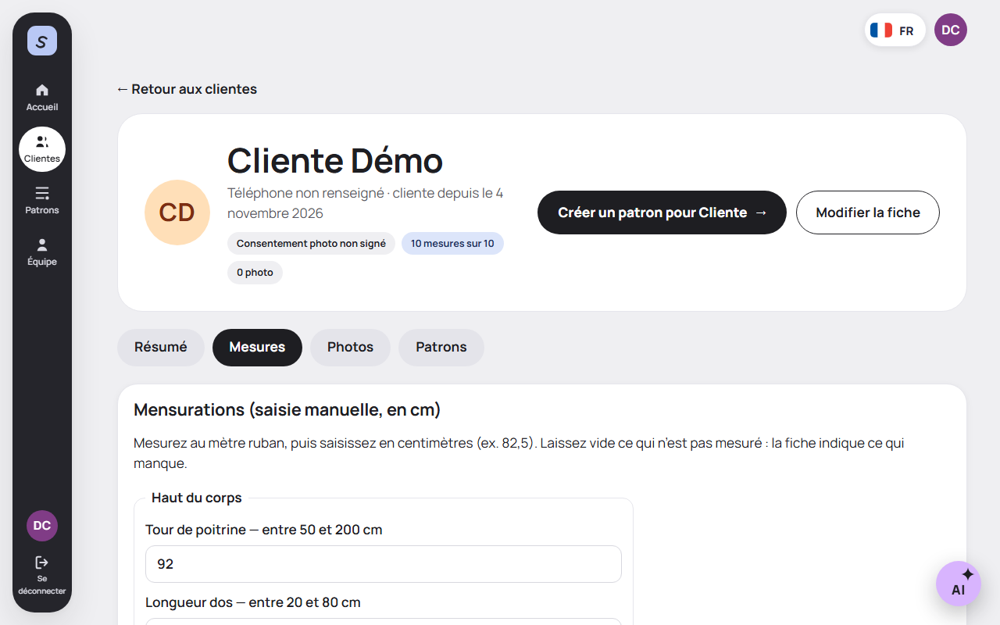
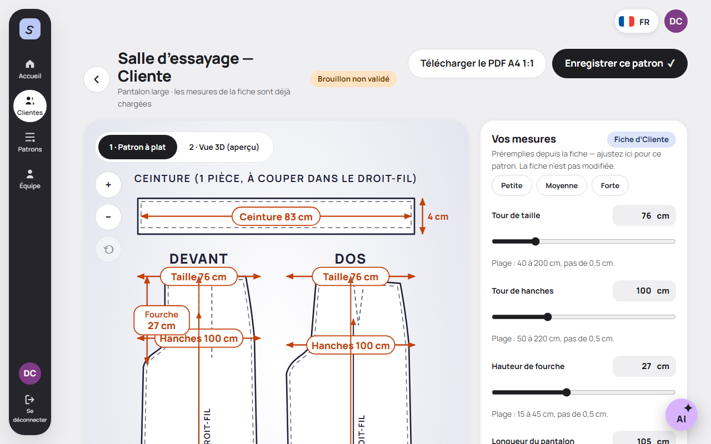

# Studio Couture

**From a client's measurements to a to-scale sewing pattern — without the hours of hand calculation.**

Studio Couture is a server-rendered web app (SvelteKit + TypeScript, installable as a PWA) built for sewing workshops and tailors in Benin and West Africa — small ateliers where work is mobile-first, connections can be slow, and jobs are priced in FCFA. It is bilingual **French / English**, French first.

> **Honest status:** this is a working hackathon build, not a finished product. Every generated pattern is an **unvalidated draft** that a master tailor must review before cutting. See [Known limitations](#known-limitations).

## The problem

A tailor who takes a custom order repeats the same slow, error-prone work every time: take the client's measurements, do the pattern geometry by hand with pencil and paper, scale it, and only then cut. It takes hours per garment, mistakes are expensive (fabric is the client's money), and nothing is kept from one order to the next.

## The solution

1. Create the client record once, with her measurements (checked against allowed ranges).
2. Pick one of **3 catalogue models** — **wide-leg trousers** (`pantalon_large`), **sheath dress** (`robe_fourreau`), **straight skirt** (`jupe_droite`) — or let the optional AI assistant recognize it (below).
3. The **pattern engine computes** the flat, dimensioned pattern from the measurements. The seamstress adjusts, validates, and saves it to the client record.
4. Export the **to-scale A4 PDF (1:1)** and cut. An indicative 3D preview exists for the trousers; the flat pattern is always the reference.

## Demo — no database, no key, 2 commands

```bash
npm install
npm run demo
```

Then open <http://127.0.0.1:3000>. The demo builds the app and starts it with an **in-memory repository only**: no PostgreSQL, no `.env`, no API key, temporary secrets generated in memory and never written to disk. It seeds a fictional workshop and a fictional client with complete measurements:

| Demo account (fictional, local only) | |
| --- | --- |
| Login | `demo@exemple.bj` |
| Password | `demo-studio-couture` |

Everything disappears when you stop the server (Ctrl+C). A public guided demo without an account is also available at `/demo`.

**In demo mode the AI assistant is deliberately not configured**: the “AI” button is visible on every connected page and the chat honestly says “Assistant bientôt disponible” (“coming soon”) — no model call is made. The screenshots below show exactly that real state.

## Screenshots (demo mode, via Playwright — `node scripts/captures.mjs`)

| | |
| --- | --- |
|  |  |
| Public home | Connected dashboard, floating “AI” button (bottom right) |
|  |  |
| Chat box in demo mode: “coming soon”, no fake result | Client measurement form (demo client, 10/10 measures) |
|  | |
| Fitting room: flat pattern computed by the engine, “unvalidated draft” | |

## Features (what actually works today)

- **Client records**: measurements with per-measure allowed ranges, consented photos, saved patterns per client; data is strictly scoped per workshop.
- **Pattern engine, 3 models**: wide-leg trousers, sheath dress, straight skirt — each with typed options (e.g. hem width, neckline, sleeves). Pieces are computed geometrically, dimensioned, and exported as a **to-scale A4 PDF**.
- **Fitting room**: flat pattern (authoritative) + indicative 3D preview where available; every pattern is labelled an unvalidated draft.
- **Quick pattern without a client** (`/patron/mesures` → `/patron/apercu` → PDF), and a public guided demo at `/demo`.
- **Floating AI assistant** (optional, connected pages): describe a garment in **text**, attach a **photo** (JPEG/PNG/WebP ≤ 5 MB), or ask a question. It recognizes the catalogue model, proposes options, and — once you give height and build in the chat — **indicative estimated measurements**, always labelled *“Estimation indicative, à vérifier au mètre ruban.”* A button opens the measurement form prefilled with those editable estimates; **nothing is saved to a client record unless the seamstress submits the form**. Out-of-catalogue garments get an honest “not available yet”, with the 3 models offered instead.
- **Bilingual FR/EN** throughout, mobile-first, works with plain form POSTs (progressive enhancement).
- **Privacy by design**: assistant photos are processed in memory, stripped of metadata, **never stored and never logged**; client-record photos require explicit consent, are encrypted (AES-256-GCM), auto-deleted after 7 days, and never used for training. No client data is sent to the AI — only the garment text/photo and the height/build declared in the chat.

## The AI never draws the pattern

The assistant only proposes a model, options inside the registry's ranges, and clamped indicative estimates. Its JSON is strictly validated (unknown model refused, never substituted; unknown keys dropped). **The TypeScript pattern engine always computes the geometry**, and the seamstress validates before anything is saved. See `docs/META_USAGE.md` for exactly how Meta technology is used, and `docs/ARCHITECTURE.md` for the short architecture.

## Architecture (short)

SvelteKit SSR (TypeScript, adapter-node) → `Repository` interface → PostgreSQL in production, in-memory for demo/tests. The pattern registry (`src/lib/patterns/registre.ts`) is the single source of truth for the 3 models, their measurement ranges, and their options; pure geometry modules compute every piece and the A4 PDF. The optional AI assistant sits behind `POST /api/suggestion-modele` (session + CSRF + 20 req/h/workshop), strictly validated, and never computes geometry. Passwords use scrypt; client photos are AES-256-GCM encrypted and deleted after 7 days. Full version: `docs/ARCHITECTURE.md`. Developer notes (routes, ORIGIN/CSRF in production, sign-up rules, project conventions): `docs/NOTES_DEVELOPPEUR.md`.

## Installation (production)

Requirements: Node ≥ 20, PostgreSQL (database `studio_couture`).

```bash
npm install
cp .env.example .env   # fill in the variables below — .env.example ships with NO secret values
psql "$STUDIO_COUTURE_DATABASE_URL" -f migrations/0001_init.sql
# apply the remaining migrations in order (0002 … 0004)
npm run build && node build/index.js
```

## Environment variables (names only — set real values in your own `.env`, never commit it)

| Variable | Purpose |
| --- | --- |
| `STUDIO_COUTURE_DATABASE_URL` | PostgreSQL connection (`DATABASE_URL` accepted as fallback) |
| `STUDIO_COUTURE_PHOTO_ENCRYPTION_KEY_BASE64` | Exactly 32 bytes, base64 (`openssl rand -base64 32`) — client photos encryption |
| `STUDIO_COUTURE_SESSION_SECRET` | ≥ 32 bytes — session/CSRF secret |
| `ORIGIN` | Public origin actually used in the browser (scheme + host + port); required in production for CSRF checks |
| `BODY_SIZE_LIMIT` | Request body cap, must cover 5 MB photos (e.g. `6M` in `.env.example`) |
| `PHOTO_RETENTION_DAYS` | Client photo retention (default in `.env.example`; 7 days) |
| `INSCRIPTION_OUVERTE` | Optional; `false` closes public sign-up (open by default) |
| `STUDIO_COUTURE_REPOSITORY` | `memoire` for demo/tests only — never in production |
| `STUDIO_COUTURE_IA_API_KEY` | Optional AI assistant key (server-side only, never logged) |
| `STUDIO_COUTURE_IA_BASE_URL` | Optional AI endpoint (Meta API, `POST /v1/messages` compatible) |
| `STUDIO_COUTURE_IA_MODELE` | Optional AI model name (see `docs/META_USAGE.md`) |

Startup refuses to boot if the session secret or photo key is missing/invalid. Owner diagnostic for the assistant with a real key and a real photo (prints the raw model answer and what it reported seeing, never the key):

```bash
node --env-file="$HOME/studio-couture.env" scripts/diagnostic-assistant.mjs "un pantalon très ample"
node --env-file="$HOME/studio-couture.env" scripts/diagnostic-assistant.mjs --photo path/to/photo.jpg
```

## Tests

```bash
npm test            # unit tests (Vitest, fake AI client — no network)
npm run check       # svelte-check, 0 errors / 0 warnings expected
npm run build       # production build
npm run test:e2e    # Playwright against the in-memory repository
```

Last full run recorded in `HANDOFF.md`. At the phase-12 checkpoint: **187 unit tests passed / 6 skipped, check clean on 918 files, 38/38 Playwright**.

## Known limitations

- Patterns are **drafts not yet validated by a master tailor** — do not cut fabric from them without professional review.
- The 3D preview is indicative (generated from dimensions), not a drape simulation.
- AI photo recognition: text recognition was verified with the real model; the corrected photo prompt is covered by fake-client unit tests and still deserves a real-photo re-check by the operator (diagnostic script above). AI estimates are indicative only.
- No e-mail verification and no “forgotten password” flow yet; rate limiters are in-memory (single-instance).
- Fabric quantity / quote (“métrage et devis”) is not implemented yet.
- Before any real public launch: see `docs/A_FAIRE_AVANT_MISE_EN_LIGNE.md`.

## Security notes for reviewers

- Tracked files were audited for this submission: no `.env*` other than the value-free `.env.example`, no client PDFs, no client photos, no encrypted blobs, and `docs/references-locales/` / `docs/maquette/` are git-ignored and untracked.
- The home-page garment photo (`static/img/accueil-pantalon-bleu.jpg`) was provided by the project owner, who confirms the rights; an earlier downloaded image was removed from the repository and its history.
- Test fixtures use obviously fictional identities (`demo@exemple.bj`, “Cliente Démo”).

## Built with Muse Code

Built with Muse Code (Meta). Studio Couture was built with **Muse Code, Meta's coding agent**, driven by the project instructions, the running state file `HANDOFF.md`, and the phase briefs in `docs/` (`PHASE_0.md`, `PROMPT_*.md`), with tests run after every phase. Product and design briefs were drafted with the help of another AI assistant; the code was written and tested with Muse Code (Meta's coding agent).

Meta usage — runtime and development — is detailed honestly in `docs/META_USAGE.md`.

## License

MIT — see `LICENSE`. Copyright (c) 2026 Sunday Oscar AMINTCHI.

---

## Résumé en français

**Studio Couture** aide les ateliers de couture et les tailleurs (contexte Bénin / Afrique de l'Ouest, budgets en FCFA) à passer des mesures d'une cliente à un patron à l'échelle sans des heures de calcul au crayon.

- **3 modèles** au catalogue : pantalon large, robe fourreau, jupe droite. Mesures de la cliente saisies une fois (bornes contrôlées), **patron à plat coté calculé par le moteur**, **PDF A4 à l'échelle 1:1**, aperçu 3D indicatif pour le pantalon.
- **Assistant IA optionnel** (texte + photo) : il reconnaît le modèle du catalogue et propose des **mesures estimées indicatives** — toujours « à vérifier au mètre ruban ». **Le moteur calcule toujours le patron**, la couturière valide avant tout enregistrement. Photos de l'assistant **jamais conservées** (mémoire uniquement, métadonnées retirées) ; photos des fiches clientes chiffrées et supprimées après 7 jours.
- **Bilingue FR/EN**, mobile d'abord, installable (PWA).
- **Démo sans base ni clé** : `npm install` puis `npm run demo` → http://127.0.0.1:3000 (compte fictif `demo@exemple.bj` / `demo-studio-couture`). En démo, l'assistant annonce honnêtement « Assistant bientôt disponible ».
- **Limites assumées** : patrons = brouillons non validés par un maître tailleur, pas de vérification d'e-mail ni de mot de passe oublié, métrage/devis pas encore implémenté. Détails dans la partie anglaise ci-dessus et `docs/A_FAIRE_AVANT_MISE_EN_LIGNE.md`.
